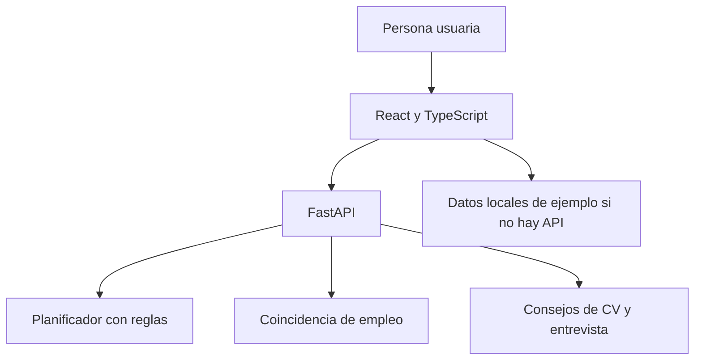

# Arquitectura de Mi Ahorro

## Prototipo actual

La interfaz puede recorrerse sola con datos locales. Cuando la API está activa, usa el catálogo, planificador y recomendaciones de la API. Ninguna capa persiste perfiles.

## Componentes

- **Frontend:** `frontend/`, React 18, TypeScript y Vite. Diseño adaptable; navegación por secciones; formularios etiquetados; estado solo en memoria de la sesión.
- **Backend:** `backend/main.py`, FastAPI y Pydantic. Endpoints con validación de rangos y límite de texto. CORS acepta por defecto los orígenes locales de Vite; el despliegue debe definir `CORS_ORIGINS` de forma explícita.
- **Datos de demostración:** catálogo y cargos ficticios, marcados en las respuestas con `is_demo`. Los enlaces de empleo son `example.com`.
- **Recomendaciones:** reglas locales transparentes para repartir el presupuesto y comparar palabras/ubicación. No son un modelo de IA ni miden probabilidad de ahorrar o conseguir empleo.
- **Calidad:** `backend/tests/` valida respuestas y límites; `.github/workflows/ci.yml` instala dependencias, ejecuta pruebas y compila el frontend.

## Contratos para datos reales

Antes de presentar precios se debe guardar producto y presentación, comercio/fuente, zona, moneda, precio, fecha de consulta y forma de verificación. Antes de mostrar una oferta se debe guardar título, empleador, lugar/modalidad, enlace original, fecha de consulta, vigencia y estado de verificación. La UI debe diferenciar datos comunitarios de datos de comercio y mostrar cuándo están desactualizados.

## Privacidad y despliegue

- No se solicita cuenta ni se persisten CV, habilidades, presupuesto o compras.
- El texto de asistencia puede enviarse a la API local configurada; no se almacena ni se manda a proveedores externos.
- El frontend tiene un workflow manual para GitHub Pages. La API requiere un servicio backend independiente y una configuración CORS específica.
- No incorporar secretos al repositorio; usar variables del entorno del host cuando se integre un proveedor externo.
