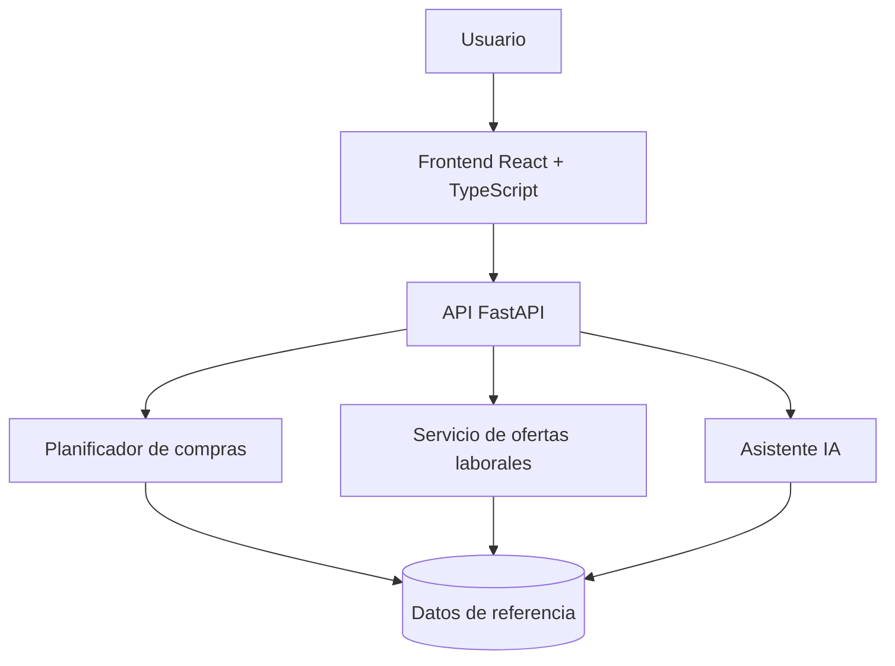

# Arquitectura técnica propuesta

> Diseño orientativo para una implementación futura.

## Frontend
Interfaz móvil adaptable con secciones de presupuesto, lista de compras, comparación y empleos.

## Backend
API REST en Python/FastAPI para validar entradas, administrar consultas y separar la lógica de recomendaciones.

## Datos
Modelo inicial por definir: productos, precios con fecha y comercio, perfiles opcionales y enlaces de ofertas. No publicar datos personales ni credenciales.

## IA y seguridad
- Explicar que las recomendaciones son orientativas.
- Mostrar fuentes y fecha de actualización.
- Evitar inventar ofertas o precios.
- Validar entradas y limitar peticiones.
- Solicitar consentimiento antes de guardar datos personales.
- Mantener claves de servicios en variables de entorno.

## Criterios de ingeniería
Pruebas de API y componentes, accesibilidad, documentación de endpoints y CI cuando exista código funcional.
