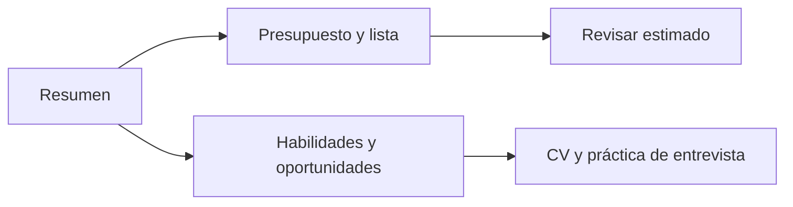

# Diseño inicial del prototipo

## Objetivo de diseño

Probar en español un flujo sencillo, usable desde el teléfono y con avisos visibles cuando los datos son ilustrativos. La interfaz no pide crear una cuenta para recorrer la demo.

## Recorrido

## Pantallas

| Pantalla | Contenido principal | Acción para validar |
| --- | --- | --- |
| Resumen | Presentación del propósito, aviso de demo y accesos a compras y oportunidades. | Identificar en pocos segundos qué resuelve Mi Ahorro. |
| Compras | Presupuesto, número de personas, productos elegidos, lista estimada y saldo. | Crear una lista y entender que los precios son ficticios. |
| Oportunidades | Habilidades y ubicación, tarjetas de ejemplo, porcentaje explicado y enlace de prueba. | Entender que son ejemplos sin vacantes activas. |
| Perfil | Consejos generales para CV, preguntas de práctica y aviso de privacidad. | Usar el asistente sin asumir que guarda el texto o genera respuestas con IA. |

## Decisiones visuales

- Paleta clara con verde para acciones principales y tonos cálidos para avisos.
- Contenido en tarjetas y botones con texto, no solo íconos.
- Navegación lateral en escritorio y barra superior compacta en pantallas pequeñas.
- Etiquetas de formulario, estados de foco visibles, encabezados semánticos y enlace para saltar al contenido.
- Sin fuentes remotas, analítica, autenticación ni almacenamiento local en esta versión.

## Estado

La implementación navegable está en `frontend/`. Este documento describe el primer prototipo técnico, no evidencia una prueba con usuarios. El protocolo para validarlo está en [VALIDACION_USUARIOS.md](VALIDACION_USUARIOS.md).
